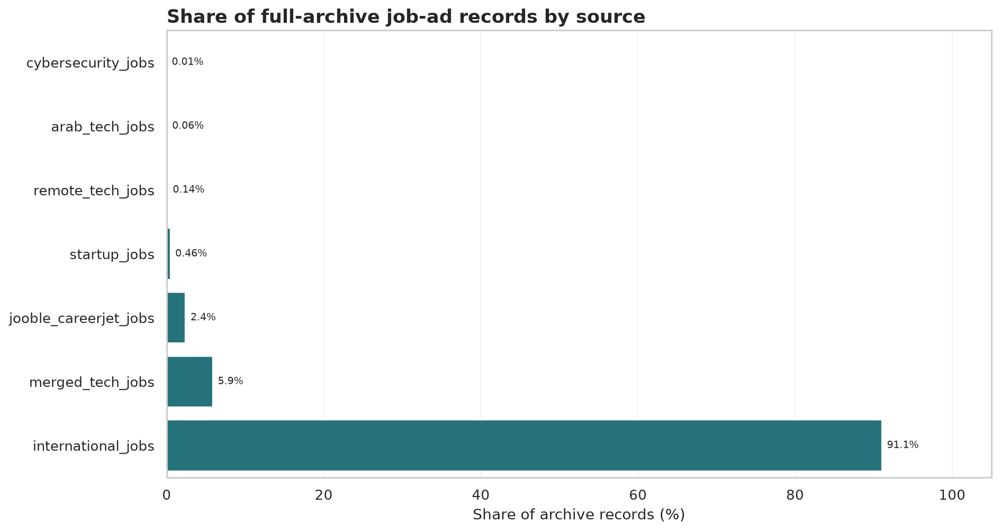
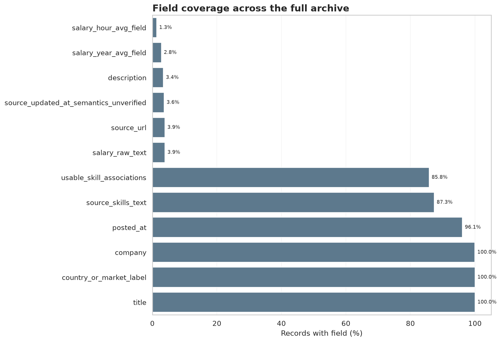
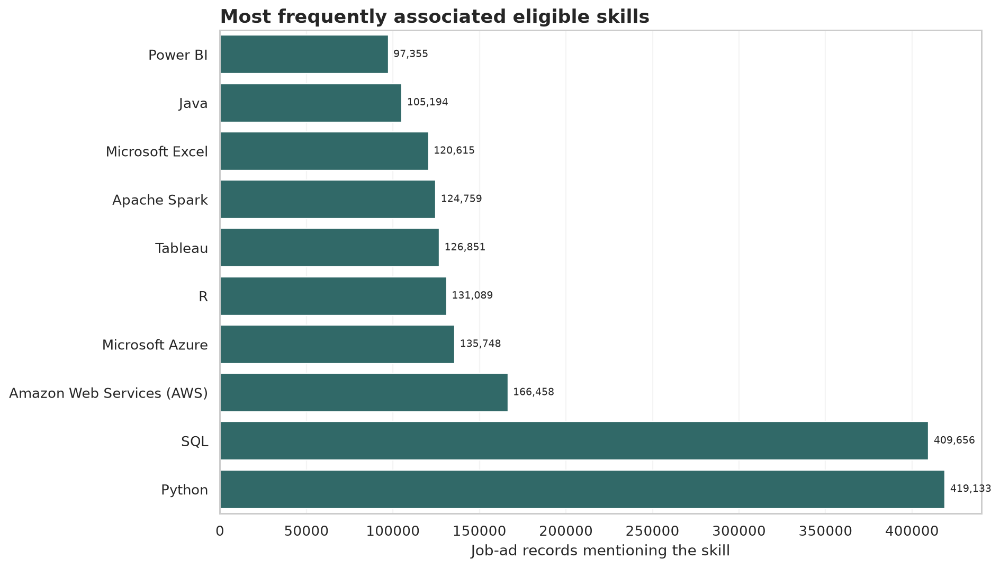
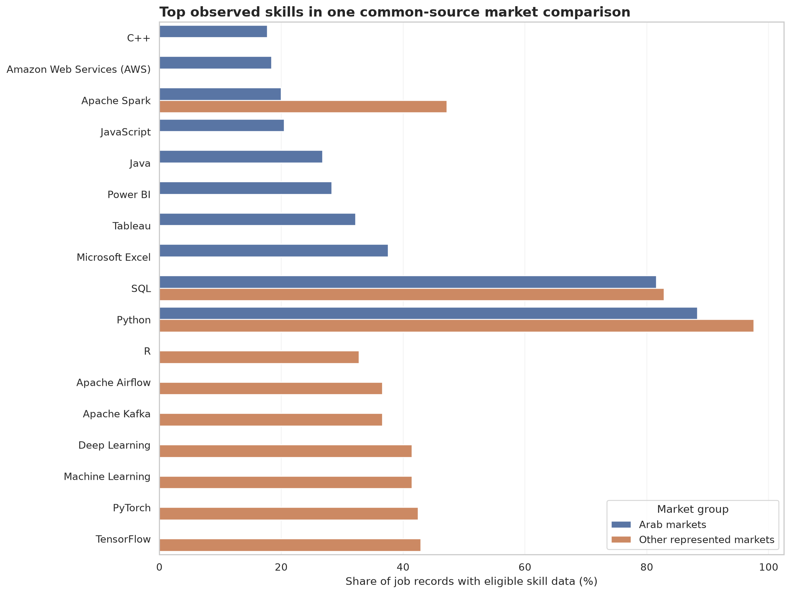
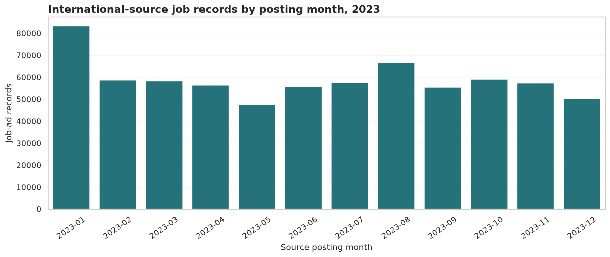

# Pre-Backend Data Analysis

**Database:** local SQLite, imported archive `full_archive_parquet_v1_20261028`. 
**Inputs:** read-only queries against the local SQLite snapshot; no source files or database rows were changed by this report. 
**Unit of analysis:** one retained source job-ad record unless a section explicitly counts skill associations.

## Executive findings

- The archive retains **775,155 job-ad records** and **4,026,953 job-skill assignments**. The reviewed analysis includes **3,701,019 assignments** across **173 reviewed canonical skill IDs**; it excludes **265,954 exact-only assignments** from 1,320 terms awaiting review, **59,980 ambiguous assignments** from 3 terms awaiting owner review, and **0 assignments** with other policy/status mismatches.
- **664,989 records** have at least one reviewed eligible skill association. The leading observed skills are Python, SQL, Amazon Web Services (AWS), Microsoft Azure, R.
- The exact normalized-title rule (`lower(trim(title))`) yields **218,302 distinct title strings**. The leading strings are DATA ENGINEER, DATA SCIENTIST, DATA ANALYST, SENIOR DATA ENGINEER, SENIOR DATA SCIENTIST; titles are not yet a reviewed job-family taxonomy.
- There are **160 distinct supplied country/territory labels** after excluding blank and non-geographic labels. The country field has 769,105 records eligible for country-group analysis; this is a set of collected source rows, not a complete country census.
- To reduce source-mix bias, the Arab/non-Arab skill comparison is restricted to `merged_tech_jobs`: **22,442 Arab-labelled** and **17,279 other-market** country-mapped records (39,721 total). Reviewed-skill denominators are **22,398** and **17,279**; remaining Arab-labelled rows have no reviewed eligible skill link and are not treated as zero-skill. Across the full archive, 20/22 configured Arab-country labels occur (absent: Comoros, Syria); in `merged_tech_jobs`, only 17/22 occur (absent: Comoros, Djibouti, Mauritania, Somalia, Syria), not zero-opportunity claims. This is a descriptive within-source comparison, not a representative regional market estimate.
- The only approved historical monthly series in this report covers **705,866 International-source records posted in 2023**. Mixed `updated` fields are not treated as posting dates.
- Advertisements provide source URLs for **29,982 (3.87%)** records and descriptions for **26,494 (3.42%)**. Individual-ad details therefore remain secondary.
- Salary grouping and salary regression are **not ready**: the archive has 21,585 annual-average and 10,337 hourly-average field values; only 52 salary-bearing records carry a supplied currency in the salary-field profile, and compatible provenance/pay-period coverage is not established.
- The role×country salary audit contains 58,267 salary-field records across 25,956 exact-title/country pairs; 52 have an explicit currency, but only 0 annual and 0 hourly values have a matching explicit currency and pay period. These rows do not support a defensible mean or median by role and country; annual/hourly/raw-text counts overlap and are shown separately.
- **91 exact duplicate source rows** are retained and flagged. No cross-source deduplication is claimed. Every stored listing has unverified activity status.
- The archive contains 32 learning-resource records, with 20 source-marked `free_verified`; however, 32 have `verified_on` values after the archive build date. No resource may be promoted as currently free until the course page, price, language, access conditions, and date are rechecked.

## Dataset scope and source coverage

The source rows are grouped into a 2023 historical set, a latest-export snapshot with unverified listing activity, and other snapshots without a consistent period. These groups are not combined into a single current-market time series.

| source_dataset | snapshot_type | job_records | archive_share_percent |
| --- | --- | --- | --- |
| international_jobs | historical_2023_sample | 705866 | 91.06 |
| merged_tech_jobs | merged_source_snapshot_date_semantics_unverified | 45591 | 5.88 |
| jooble_careerjet_jobs | latest_export_listing_status_unverified | 18583 | 2.4 |
| startup_jobs | latest_export_listing_status_unverified | 3543 | 0.46 |
| remote_tech_jobs | latest_export_listing_status_unverified | 1075 | 0.14 |
| arab_tech_jobs | regional_snapshot_date_coverage_partial | 439 | 0.06 |
| cybersecurity_jobs | regional_snapshot_date_unavailable | 58 | 0.01 |

## Field coverage

Percentages use all archive job-ad records as the denominator. Salary text, annual-average, and hourly-average fields overlap and must not be added together.

| field_name | present_count | job_record_count | present_percent |
| --- | --- | --- | --- |
| company | 774836 | 775155 | 99.96 |
| country_or_market_label | 775051 | 775155 | 99.99 |
| description | 26494 | 775155 | 3.42 |
| posted_at | 744843 | 775155 | 96.09 |
| salary_hour_avg_field | 10337 | 775155 | 1.33 |
| salary_raw_text | 30121 | 775155 | 3.89 |
| salary_year_avg_field | 21585 | 775155 | 2.78 |
| source_skills_text | 677101 | 775155 | 87.35 |
| source_updated_at_semantics_unverified | 28123 | 775155 | 3.63 |
| source_url | 29982 | 775155 | 3.87 |
| title | 775151 | 775155 | 100.0 |
| usable_skill_associations | 664989 | 775155 | 85.79 |

## Skill curation and review gate

The analysis checks the policy and review status on both `job_skills` and `skills`. It includes only the consistent pairs `(approved_aliases, curated)` and `(exact_only, curated_exact_only)`. An `exact_only` policy by itself is not sufficient: unreviewed exact-only terms remain in SQLite but are excluded from metrics and matching until reviewed. Ambiguous `exclude_pending_review` terms are also excluded.

| skill_match_policy | skill_review_status | catalog_match_policy | catalog_review_status | analysis_decision | job_skill_assignment_count | distinct_job_record_count | distinct_skill_count | source_dataset_count |
| --- | --- | --- | --- | --- | --- | --- | --- | --- |
| exact_only | needs_review | exact_only | needs_review | excluded_needs_review | 265954 | 188297 | 1320 | 7 |
| exclude_pending_review | needs_owner_review | exclude_pending_review | needs_owner_review | excluded_owner_review | 59980 | 58601 | 3 | 4 |
| approved_aliases | curated | approved_aliases | curated | included_reviewed | 3514220 | 658926 | 169 | 7 |
| exact_only | curated_exact_only | exact_only | curated_exact_only | included_reviewed | 186799 | 174509 | 4 | 7 |

## Skill demand

The reported demand denominator is the **664,989 job records with at least one reviewed eligible skill association**. A count is distinct job records linked to a skill, not the number of repeated raw tokens. `approved_aliases` must pair with `curated`, and `exact_only` must pair with `curated_exact_only`; all pending-review terms are excluded.

| canonical_name | job_record_count | denominator_job_records | share_of_jobs_with_eligible_skills_percent | skill_match_policy | review_status |
| --- | --- | --- | --- | --- | --- |
| Python | 419133 | 664989 | 63.03 | approved_aliases | curated |
| SQL | 409656 | 664989 | 61.6 | approved_aliases | curated |
| Amazon Web Services (AWS) | 166458 | 664989 | 25.03 | approved_aliases | curated |
| Microsoft Azure | 135748 | 664989 | 20.41 | approved_aliases | curated |
| R | 131089 | 664989 | 19.71 | exact_only | curated_exact_only |
| Tableau | 126851 | 664989 | 19.08 | approved_aliases | curated |
| Apache Spark | 124759 | 664989 | 18.76 | approved_aliases | curated |
| Microsoft Excel | 120615 | 664989 | 18.14 | approved_aliases | curated |
| Java | 105194 | 664989 | 15.82 | approved_aliases | curated |
| Power BI | 97355 | 664989 | 14.64 | approved_aliases | curated |
| Git | 72661 | 664989 | 10.93 | approved_aliases | curated |
| Apache Hadoop | 64812 | 664989 | 9.75 | approved_aliases | curated |
| Docker | 61584 | 664989 | 9.26 | approved_aliases | curated |
| Apache Kafka | 59731 | 664989 | 8.98 | approved_aliases | curated |
| Scala | 56813 | 664989 | 8.54 | approved_aliases | curated |

## Role-title evidence

A role lookup may normalize case and outer whitespace and preserve punctuation. It must not silently merge semantically similar titles, levels, or abbreviations. A curated role-family taxonomy is not present in this archive.

| display_title | normalized_title | job_record_count |
| --- | --- | --- |
| DATA ENGINEER | data engineer | 56513 |
| DATA SCIENTIST | data scientist | 44977 |
| DATA ANALYST | data analyst | 44597 |
| SENIOR DATA ENGINEER | senior data engineer | 20759 |
| SENIOR DATA SCIENTIST | senior data scientist | 13859 |
| SENIOR DATA ANALYST | senior data analyst | 8576 |
| LEAD DATA ENGINEER | lead data engineer | 4139 |
| AZURE DATA ENGINEER | azure data engineer | 3599 |
| LEAD DATA SCIENTIST | lead data scientist | 3459 |
| MACHINE LEARNING ENGINEER | machine learning engineer | 3201 |
| BIG DATA ENGINEER | big data engineer | 2569 |
| BUSINESS INTELLIGENCE ANALYST | business intelligence analyst | 2558 |
| BUSINESS DATA ANALYST | business data analyst | 2488 |
| SOFTWARE ENGINEER | software engineer | 2485 |
| SENIOR SOFTWARE ENGINEER | senior software engineer | 2436 |

## Role-specific country and skill evidence

The role-by-role tables cover the 15 most frequent exact normalized title strings in this archive, selected by retained source-row count. They do not define job families. The full role-country CSV is split by source dataset, with each share using country-mapped records for that exact role and source as its denominator; the compact table below pools represented sources, uses all country-mapped rows for the exact role as its denominator, and shows how many source datasets contributed. These are retained source rows, not unique vacancies. Skill counts include only eligible reviewed links, and the denominator is role records with at least one such link.

### Role × country counts (top five exact titles, pooled archive)

| role_rank | display_title | role_record_count | country_rank | country_or_territory_label | role_country_job_record_count | country_mapped_role_records | share_of_country_mapped_role_records_percent | role_country_records_with_eligible_skills | role_country_skill_coverage_percent | role_country_source_dataset_count |
| --- | --- | --- | --- | --- | --- | --- | --- | --- | --- | --- |
| 1 | DATA ENGINEER | 56513 | 1 | United States | 11265 | 56169 | 20.06 | 10806 | 95.93 | 5 |
| 1 | DATA ENGINEER | 56513 | 2 | India | 5113 | 56169 | 9.1 | 4818 | 94.23 | 3 |
| 1 | DATA ENGINEER | 56513 | 3 | United Kingdom | 4327 | 56169 | 7.7 | 3849 | 88.95 | 3 |
| 2 | DATA SCIENTIST | 44977 | 1 | United States | 17428 | 44586 | 39.09 | 15690 | 90.03 | 5 |
| 2 | DATA SCIENTIST | 44977 | 2 | India | 4216 | 44586 | 9.46 | 3774 | 89.52 | 2 |
| 2 | DATA SCIENTIST | 44977 | 3 | United Kingdom | 2966 | 44586 | 6.65 | 2596 | 87.53 | 3 |
| 3 | DATA ANALYST | 44597 | 1 | United States | 15359 | 44470 | 34.54 | 13033 | 84.86 | 2 |
| 3 | DATA ANALYST | 44597 | 2 | United Kingdom | 3440 | 44470 | 7.74 | 2804 | 81.51 | 2 |
| 3 | DATA ANALYST | 44597 | 3 | Singapore | 1764 | 44470 | 3.97 | 1611 | 91.33 | 1 |
| 4 | SENIOR DATA ENGINEER | 20759 | 1 | United States | 5008 | 20548 | 24.37 | 4862 | 97.08 | 5 |
| 4 | SENIOR DATA ENGINEER | 20759 | 2 | India | 2245 | 20548 | 10.93 | 2156 | 96.04 | 3 |
| 4 | SENIOR DATA ENGINEER | 20759 | 3 | United Kingdom | 1921 | 20548 | 9.35 | 1755 | 91.36 | 3 |
| 5 | SENIOR DATA SCIENTIST | 13859 | 1 | United States | 5406 | 13662 | 39.57 | 4959 | 91.73 | 3 |
| 5 | SENIOR DATA SCIENTIST | 13859 | 2 | United Kingdom | 1213 | 13662 | 8.88 | 1065 | 87.8 | 3 |
| 5 | SENIOR DATA SCIENTIST | 13859 | 3 | India | 1159 | 13662 | 8.48 | 1041 | 89.82 | 3 |

### Most frequent reviewed skills by exact role (top five titles)

| role_rank | display_title | role_record_count | denominator_role_records_with_eligible_skills | skill_rank | skill_name | skill_job_record_count | share_of_role_records_with_eligible_skills_percent | skill_source_dataset_count |
| --- | --- | --- | --- | --- | --- | --- | --- | --- |
| 1 | DATA ENGINEER | 56513 | 52778 | 1 | SQL | 39475 | 74.79 | 5 |
| 1 | DATA ENGINEER | 56513 | 52778 | 2 | Python | 36938 | 69.99 | 5 |
| 1 | DATA ENGINEER | 56513 | 52778 | 3 | Amazon Web Services (AWS) | 20153 | 38.18 | 5 |
| 1 | DATA ENGINEER | 56513 | 52778 | 4 | Microsoft Azure | 19854 | 37.62 | 5 |
| 1 | DATA ENGINEER | 56513 | 52778 | 5 | Apache Spark | 18788 | 35.6 | 5 |
| 2 | DATA SCIENTIST | 44977 | 40019 | 1 | Python | 34863 | 87.12 | 5 |
| 2 | DATA SCIENTIST | 44977 | 40019 | 2 | SQL | 23855 | 59.61 | 5 |
| 2 | DATA SCIENTIST | 44977 | 40019 | 3 | R | 18339 | 45.83 | 5 |
| 2 | DATA SCIENTIST | 44977 | 40019 | 4 | TensorFlow | 8988 | 22.46 | 5 |
| 2 | DATA SCIENTIST | 44977 | 40019 | 5 | Tableau | 8731 | 21.82 | 2 |
| 3 | DATA ANALYST | 44597 | 37387 | 1 | SQL | 26534 | 70.97 | 3 |
| 3 | DATA ANALYST | 44597 | 37387 | 2 | Microsoft Excel | 17489 | 46.78 | 3 |
| 3 | DATA ANALYST | 44597 | 37387 | 3 | Python | 16725 | 44.73 | 3 |
| 3 | DATA ANALYST | 44597 | 37387 | 4 | Tableau | 14446 | 38.64 | 3 |
| 3 | DATA ANALYST | 44597 | 37387 | 5 | Power BI | 12616 | 33.74 | 3 |
| 4 | SENIOR DATA ENGINEER | 20759 | 19800 | 1 | Python | 14866 | 75.08 | 5 |
| 4 | SENIOR DATA ENGINEER | 20759 | 19800 | 2 | SQL | 14724 | 74.36 | 5 |
| 4 | SENIOR DATA ENGINEER | 20759 | 19800 | 3 | Amazon Web Services (AWS) | 9708 | 49.03 | 5 |
| 4 | SENIOR DATA ENGINEER | 20759 | 19800 | 4 | Apache Spark | 8614 | 43.51 | 5 |
| 4 | SENIOR DATA ENGINEER | 20759 | 19800 | 5 | Microsoft Azure | 8009 | 40.45 | 5 |
| 5 | SENIOR DATA SCIENTIST | 13859 | 12568 | 1 | Python | 11305 | 89.95 | 6 |
| 5 | SENIOR DATA SCIENTIST | 13859 | 12568 | 2 | SQL | 7576 | 60.28 | 6 |
| 5 | SENIOR DATA SCIENTIST | 13859 | 12568 | 3 | R | 5277 | 41.99 | 5 |
| 5 | SENIOR DATA SCIENTIST | 13859 | 12568 | 4 | Amazon Web Services (AWS) | 3407 | 27.11 | 3 |
| 5 | SENIOR DATA SCIENTIST | 13859 | 12568 | 5 | TensorFlow | 3353 | 26.68 | 6 |

### Top skills within the leading role × country pairs

The CSV includes the five most represented countries for each of the 15 frequent exact titles and the top five eligible skills within each pair. The compact table below displays the first five roles, their top two countries, and the top three skills. It shows the number of contributing source datasets and the denominator for skill shares; it is descriptive of the pooled archive, not a country labor-market estimate.

| role_rank | display_title | country_rank | country_or_territory_label | role_country_job_record_count | denominator_role_country_records_with_eligible_skills | role_country_source_dataset_count | skill_rank | skill_name | skill_job_record_count | share_of_role_country_records_with_eligible_skills_percent |
| --- | --- | --- | --- | --- | --- | --- | --- | --- | --- | --- |
| 1 | DATA ENGINEER | 1 | United States | 11265 | 10806 | 5 | 1 | SQL | 8575 | 79.35 |
| 1 | DATA ENGINEER | 1 | United States | 11265 | 10806 | 5 | 2 | Python | 8025 | 74.26 |
| 1 | DATA ENGINEER | 1 | United States | 11265 | 10806 | 5 | 3 | Amazon Web Services (AWS) | 4825 | 44.65 |
| 1 | DATA ENGINEER | 2 | India | 5113 | 4818 | 3 | 1 | SQL | 3690 | 76.59 |
| 1 | DATA ENGINEER | 2 | India | 5113 | 4818 | 3 | 2 | Python | 3375 | 70.05 |
| 1 | DATA ENGINEER | 2 | India | 5113 | 4818 | 3 | 3 | Amazon Web Services (AWS) | 2123 | 44.06 |
| 2 | DATA SCIENTIST | 1 | United States | 17428 | 15690 | 5 | 1 | Python | 13706 | 87.36 |
| 2 | DATA SCIENTIST | 1 | United States | 17428 | 15690 | 5 | 2 | SQL | 9961 | 63.49 |
| 2 | DATA SCIENTIST | 1 | United States | 17428 | 15690 | 5 | 3 | R | 8293 | 52.86 |
| 2 | DATA SCIENTIST | 2 | India | 4216 | 3774 | 2 | 1 | Python | 3258 | 86.33 |
| 2 | DATA SCIENTIST | 2 | India | 4216 | 3774 | 2 | 2 | SQL | 2139 | 56.68 |
| 2 | DATA SCIENTIST | 2 | India | 4216 | 3774 | 2 | 3 | R | 1572 | 41.65 |
| 3 | DATA ANALYST | 1 | United States | 15359 | 13033 | 2 | 1 | SQL | 9122 | 69.99 |
| 3 | DATA ANALYST | 1 | United States | 15359 | 13033 | 2 | 2 | Microsoft Excel | 6481 | 49.73 |
| 3 | DATA ANALYST | 1 | United States | 15359 | 13033 | 2 | 3 | Tableau | 5122 | 39.3 |
| 3 | DATA ANALYST | 2 | United Kingdom | 3440 | 2804 | 2 | 1 | SQL | 1753 | 62.52 |
| 3 | DATA ANALYST | 2 | United Kingdom | 3440 | 2804 | 2 | 2 | Microsoft Excel | 1472 | 52.5 |
| 3 | DATA ANALYST | 2 | United Kingdom | 3440 | 2804 | 2 | 3 | Power BI | 1075 | 38.34 |
| 4 | SENIOR DATA ENGINEER | 1 | United States | 5008 | 4862 | 5 | 1 | SQL | 3941 | 81.06 |
| 4 | SENIOR DATA ENGINEER | 1 | United States | 5008 | 4862 | 5 | 2 | Python | 3856 | 79.31 |
| 4 | SENIOR DATA ENGINEER | 1 | United States | 5008 | 4862 | 5 | 3 | Amazon Web Services (AWS) | 2615 | 53.78 |
| 4 | SENIOR DATA ENGINEER | 2 | India | 2245 | 2156 | 3 | 1 | SQL | 1680 | 77.92 |
| 4 | SENIOR DATA ENGINEER | 2 | India | 2245 | 2156 | 3 | 2 | Python | 1555 | 72.12 |
| 4 | SENIOR DATA ENGINEER | 2 | India | 2245 | 2156 | 3 | 3 | Amazon Web Services (AWS) | 1144 | 53.06 |
| 5 | SENIOR DATA SCIENTIST | 1 | United States | 5406 | 4959 | 3 | 1 | Python | 4464 | 90.02 |
| 5 | SENIOR DATA SCIENTIST | 1 | United States | 5406 | 4959 | 3 | 2 | SQL | 3281 | 66.16 |
| 5 | SENIOR DATA SCIENTIST | 1 | United States | 5406 | 4959 | 3 | 3 | R | 2546 | 51.34 |
| 5 | SENIOR DATA SCIENTIST | 2 | United Kingdom | 1213 | 1065 | 3 | 1 | Python | 957 | 89.86 |
| 5 | SENIOR DATA SCIENTIST | 2 | United Kingdom | 1213 | 1065 | 3 | 2 | SQL | 622 | 58.4 |
| 5 | SENIOR DATA SCIENTIST | 2 | United Kingdom | 1213 | 1065 | 3 | 3 | R | 346 | 32.49 |

## Country and market comparison

The 22-name Arab cohort is defined in `analysis/sql/10_arab_vs_other_market_skills.sql`. Across all sources, 20/22 configured Arab-country labels occur (absent from the archive: Comoros, Syria); only 17/22 occur in the `merged_tech_jobs` comparison source (absent there: Comoros, Djibouti, Mauritania, Somalia, Syria). These missing labels indicate no matching country value in this archive/source, not zero job opportunities. The Arab-versus-other skill comparison uses only `merged_tech_jobs`, the source with both cohorts, and excludes country-mapped records without reviewed eligible skills from the skill-share denominator. This controls the largest source-mix difference but does not fix unknown date semantics or other within-source bias. `Remote (Anywhere)`, `Worldwide`, `Other/Unknown`, blank, and NULL values are not treated as countries. The raw archive has no standard ISO country codes; a country map must be gated on reviewed name-to-geometry mapping and must provide a table/list alternative.

Top supplied country/territory labels:

| country_or_territory_label | job_record_count |
| --- | --- |
| United States | 223430 |
| India | 53703 |
| United Kingdom | 43819 |
| France | 39417 |
| Germany | 28700 |
| Spain | 24000 |
| Singapore | 22095 |
| Netherlands | 19646 |
| Canada | 19368 |
| Italy | 15944 |
| Australia | 14422 |
| Mexico | 14098 |
| Poland | 13860 |
| Portugal | 13723 |
| South Africa | 11686 |

Arab-country labels actually represented in the comparison source:

| country_or_territory_label | job_record_count |
| --- | --- |
| Algeria | 76 |
| Bahrain | 287 |
| Egypt | 6655 |
| Iraq | 95 |
| Jordan | 797 |
| Kuwait | 584 |
| Lebanon | 354 |
| Libya | 37 |
| Morocco | 1077 |
| Oman | 154 |
| Palestine | 13 |
| Qatar | 1166 |
| Saudi Arabia | 3304 |
| Sudan | 36 |
| Tunisia | 599 |
| United Arab Emirates | 7202 |
| Yemen | 6 |

The skills below are shown as within-group shares, with counts and denominators. Both groups come from `merged_tech_jobs`; its snapshot period and listing activity are still unverified, so results describe only that collected source snapshot and do not generalize to current Arab or global job markets.

| market_group | canonical_name | job_record_count | jobs_with_eligible_skills | share_of_jobs_with_eligible_skills_percent |
| --- | --- | --- | --- | --- |
| Arab markets | Python | 19781 | 22398 | 88.32 |
| Arab markets | SQL | 18280 | 22398 | 81.61 |
| Arab markets | Microsoft Excel | 8412 | 22398 | 37.56 |
| Arab markets | Tableau | 7220 | 22398 | 32.24 |
| Arab markets | Power BI | 6338 | 22398 | 28.3 |
| Arab markets | Java | 5998 | 22398 | 26.78 |
| Arab markets | JavaScript | 4589 | 22398 | 20.49 |
| Arab markets | Apache Spark | 4476 | 22398 | 19.98 |
| Arab markets | Amazon Web Services (AWS) | 4121 | 22398 | 18.4 |
| Arab markets | C++ | 3974 | 22398 | 17.74 |
| Other represented markets | Python | 16865 | 17279 | 97.6 |
| Other represented markets | SQL | 14318 | 17279 | 82.86 |
| Other represented markets | Apache Spark | 8152 | 17279 | 47.18 |
| Other represented markets | TensorFlow | 7416 | 17279 | 42.92 |
| Other represented markets | PyTorch | 7339 | 17279 | 42.47 |
| Other represented markets | Machine Learning | 7168 | 17279 | 41.48 |
| Other represented markets | Deep Learning | 7166 | 17279 | 41.47 |
| Other represented markets | Apache Kafka | 6326 | 17279 | 36.61 |
| Other represented markets | Apache Airflow | 6323 | 17279 | 36.59 |
| Other represented markets | R | 5661 | 17279 | 32.76 |

## Historical date evidence

Only the `international_jobs` source is used here. Its explicit `posted_at` values fall in 2023 and account for 705,866 rows. The chart is a historical source-snapshot distribution; it is not a current or forward-looking hiring trend.

| posting_month | job_record_count |
| --- | --- |
| 2023-01 | 83220 |
| 2023-02 | 58616 |
| 2023-03 | 58254 |
| 2023-04 | 56395 |
| 2023-05 | 47527 |
| 2023-06 | 55709 |
| 2023-07 | 57516 |
| 2023-08 | 66605 |
| 2023-09 | 55409 |
| 2023-10 | 59032 |
| 2023-11 | 57326 |
| 2023-12 | 50257 |

## Salary and other model feasibility findings

Salary fields are preserved as source values. Annual and hourly values are not combined. No conversion, imputation, or assumption that an estimate is an employer offer is applied. A salary chart or salary regression must remain disabled until a comparable, sufficiently sized set has a known currency, pay period, provenance, and defensible target definition.

| source_dataset | salary_provenance_status | salary_currency | salary_basis | salary_rate | records_with_any_salary_field | salary_text_records | annual_value_records | hourly_value_records | currency_present_records | basis_present_records |
| --- | --- | --- | --- | --- | --- | --- | --- | --- | --- | --- |
| international_jobs | source_or_origin_unverified | not_supplied | year | year | 19921 | 0 | 19921 | 0 | 0 | 19921 |
| merged_tech_jobs | estimate_or_research_indicated | not_supplied | not_supplied | not_supplied | 19912 | 19912 | 0 | 0 | 0 | 0 |
| international_jobs | source_or_origin_unverified | not_supplied | hour | hour | 9336 | 0 | 0 | 9336 | 0 | 9336 |
| jooble_careerjet_jobs | source_or_origin_unverified | not_supplied | not_supplied | not_supplied | 5243 | 5243 | 0 | 0 | 0 | 0 |
| merged_tech_jobs | source_or_origin_unverified | not_supplied | year | year | 1664 | 1664 | 1664 | 0 | 0 | 1664 |
| startup_jobs | source_or_origin_unverified | not_supplied | not_supplied | not_supplied | 1591 | 1591 | 0 | 0 | 0 | 0 |
| merged_tech_jobs | source_or_origin_unverified | not_supplied | hour | hour | 1001 | 1001 | 0 | 1001 | 0 | 1001 |
| merged_tech_jobs | source_or_origin_unverified | not_supplied | not_supplied | not_supplied | 547 | 547 | 0 | 0 | 0 | 0 |
| cybersecurity_jobs | not_available | not_supplied | not_supplied | not_supplied | 56 | 56 | 0 | 0 | 0 | 0 |
| remote_tech_jobs | source_or_origin_unverified | not_supplied | not_supplied | not_supplied | 50 | 50 | 0 | 0 | 0 | 0 |
| arab_tech_jobs | source_or_origin_unverified | EGP | posted | not_supplied | 34 | 34 | 0 | 0 | 34 | 34 |
| arab_tech_jobs | source_or_origin_unverified | SAR | posted | not_supplied | 9 | 9 | 0 | 0 | 9 | 9 |
| arab_tech_jobs | source_or_origin_unverified | JOD | posted | not_supplied | 8 | 8 | 0 | 0 | 8 | 8 |
| merged_tech_jobs | estimate_or_research_indicated | not_supplied | month | month | 3 | 3 | 0 | 0 | 0 | 3 |
| cybersecurity_jobs | source_or_origin_unverified | not_supplied | not_supplied | not_supplied | 2 | 2 | 0 | 0 | 0 | 0 |
| arab_tech_jobs | source_or_origin_unverified | AED | posted | not_supplied | 1 | 1 | 0 | 0 | 1 | 1 |

### Salary fields by exact role and country

The role×country audit is restricted to rows with a non-empty exact title and a geographic country label. It contains 58,267 salary-field records in 25,956 normalized-title/country pairs; 52 records provide a currency, 21,149 have an annual-value field, and 9,848 have an hourly-value field. These field counts can overlap. There are 0 annual and 0 hourly values on the same records as both an explicit currency and matching pay-period fields. Because those comparable-amount candidate counts are zero, no mean or median is computed by role and country.

Largest role/source/country salary-field groups (raw-text, annual and hourly fields remain separate):

| source_dataset | display_title | country_or_territory_label | salary_currency | salary_basis | salary_rate | records_with_any_salary_field | salary_raw_text_records | annual_value_field_records | hourly_value_field_records | records_with_explicit_currency |
| --- | --- | --- | --- | --- | --- | --- | --- | --- | --- | --- |
| merged_tech_jobs | DATA SCIENTIST | United States | not_supplied | not_supplied | not_supplied | 1888 | 1888 | 0 | 0 | 0 |
| international_jobs | DATA SCIENTIST | United States | not_supplied | year | year | 1280 | 0 | 1280 | 0 | 0 |
| international_jobs | DATA ANALYST | United States | not_supplied | year | year | 1152 | 0 | 1152 | 0 | 0 |
| international_jobs | DATA ANALYST | United States | not_supplied | hour | hour | 1023 | 0 | 0 | 1023 | 0 |
| international_jobs | DATA ENGINEER | United States | not_supplied | year | year | 898 | 0 | 898 | 0 | 0 |
| merged_tech_jobs | DATA ANALYST | United Arab Emirates | not_supplied | not_supplied | not_supplied | 877 | 877 | 0 | 0 | 0 |
| merged_tech_jobs | SENIOR DATA SCIENTIST | United States | not_supplied | not_supplied | not_supplied | 546 | 546 | 0 | 0 | 0 |
| international_jobs | Senior Data Engineer | United States | not_supplied | year | year | 538 | 0 | 538 | 0 | 0 |
| international_jobs | DATA ENGINEER | United States | not_supplied | hour | hour | 532 | 0 | 0 | 532 | 0 |
| international_jobs | DATA SCIENTIST | United States | not_supplied | hour | hour | 473 | 0 | 0 | 473 | 0 |
| international_jobs | SENIOR DATA SCIENTIST | United States | not_supplied | year | year | 431 | 0 | 431 | 0 | 0 |
| merged_tech_jobs | DATA ANALYST | Saudi Arabia | not_supplied | not_supplied | not_supplied | 372 | 372 | 0 | 0 | 0 |
| merged_tech_jobs | DATA SCIENTIST | United Arab Emirates | not_supplied | not_supplied | not_supplied | 335 | 335 | 0 | 0 | 0 |
| merged_tech_jobs | DATA ENGINEER | United Arab Emirates | not_supplied | not_supplied | not_supplied | 316 | 316 | 0 | 0 | 0 |
| international_jobs | Senior Data Analyst | United States | not_supplied | year | year | 260 | 0 | 260 | 0 | 0 |

Currency-bearing role/source/country groups (the source basis is preserved, not converted):

| source_dataset | display_title | country_or_territory_label | salary_currency | salary_basis | salary_rate | records_with_any_salary_field | records_with_explicit_currency | annual_values_with_currency_and_matching_period | hourly_values_with_currency_and_matching_period |
| --- | --- | --- | --- | --- | --- | --- | --- | --- | --- |
| arab_tech_jobs | وظيفة اخصائي دعم فني | Saudi Arabia | SAR | posted | not_supplied | 3 | 3 | 0 | 0 |
| arab_tech_jobs | وظيفة أخصائي مواقع إلكترونية | Saudi Arabia | SAR | posted | not_supplied | 2 | 2 | 0 | 0 |
| arab_tech_jobs | إستشاري أودو - (Odoo Specialist (Functional Consultant - مدينة نصر - القاهرة | Egypt | EGP | posted | not_supplied | 1 | 1 | 0 | 0 |
| arab_tech_jobs | اخصائي حاسبات وشبكات - IT helpdesk - مدينة نصر - القاهرة | Egypt | EGP | posted | not_supplied | 1 | 1 | 0 | 0 |
| arab_tech_jobs | اخصائي دعم تطبيقات - التجمع الاول - القاهرة | Egypt | EGP | posted | not_supplied | 1 | 1 | 0 | 0 |
| arab_tech_jobs | خراط معادن ( cnc و بلدى ) - العاشر من رمضان - الشرقية | Egypt | EGP | posted | not_supplied | 1 | 1 | 0 | 0 |
| arab_tech_jobs | دعم فني - العاشر من رمضان - الشرقية | Egypt | EGP | posted | not_supplied | 1 | 1 | 0 | 0 |
| arab_tech_jobs | دعم فني - مدينتى - القاهرة | Egypt | EGP | posted | not_supplied | 1 | 1 | 0 | 0 |
| arab_tech_jobs | شركة ابواب امان بحاجة إلى مساعد تركيب براتب 300 دينار | Jordan | JOD | posted | not_supplied | 1 | 1 | 0 | 0 |
| arab_tech_jobs | فنى كهرباء باور و كنترول و plc ماكينات - الجيزة - الجيزة | Egypt | EGP | posted | not_supplied | 1 | 1 | 0 | 0 |
| arab_tech_jobs | فنى ماكينة طباعة و cnc - عرعر - المملكة العربية السعودية | Egypt | EGP | posted | not_supplied | 1 | 1 | 0 | 0 |
| arab_tech_jobs | فني تشغيل CNC - مدينة العبور - القاهرة | Egypt | EGP | posted | not_supplied | 1 | 1 | 0 | 0 |
| arab_tech_jobs | فني صيانة كهربائية كنترول / باور (plc) - مدينة السادات - المنوفية | Egypt | EGP | posted | not_supplied | 1 | 1 | 0 | 0 |
| arab_tech_jobs | مبرمج اودو (عمل عن بعد) - (Odoo Developer (remote - مدينة نصر - القاهرة | Egypt | EGP | posted | not_supplied | 1 | 1 | 0 | 0 |
| arab_tech_jobs | مبرمج مواقع إلكترونية - مكة - المملكة العربية السعودية | Egypt | EGP | posted | not_supplied | 1 | 1 | 0 | 0 |

Job-family classification is not approved as a stable occupational taxonomy. A separate Naive Bayes model ranks sufficiently supported exact title strings from reviewed skill presence; its held-out evaluation and limited-scope serving status are documented in `ml/evaluation/results/ROLE_TITLE_NAIVE_BAYES_EVALUATION.md`. Salary regression remains disabled because no comparable target sample is available. Skill-vector clustering is exploratory only, not a validated occupational taxonomy.

| source_dataset | job_record_count | category_label_count | distinct_category_label_count | title_count | description_count | annual_salary_field_count | hourly_salary_field_count | currency_count | pay_basis_count |
| --- | --- | --- | --- | --- | --- | --- | --- | --- | --- |
| international_jobs | 705866 | 0 | 0 | 705866 | 0 | 19921 | 9336 | 0 | 29629 |
| merged_tech_jobs | 45591 | 6693 | 2 | 45591 | 6693 | 1664 | 1001 | 0 | 2677 |
| jooble_careerjet_jobs | 18583 | 18583 | 3 | 18579 | 18583 | 0 | 0 | 0 | 0 |
| startup_jobs | 3543 | 3543 | 3 | 3543 | 0 | 0 | 0 | 0 | 0 |
| remote_tech_jobs | 1075 | 1075 | 3 | 1075 | 1075 | 0 | 0 | 0 | 0 |
| arab_tech_jobs | 439 | 439 | 22 | 439 | 143 | 0 | 0 | 438 | 439 |
| cybersecurity_jobs | 58 | 0 | 0 | 58 | 0 | 0 | 0 | 0 | 0 |

## Learning-resource review gate

SQLite contains 32 curated resource records. The source labels 20 as `free_verified`, but 32 records carry a `verified_on` value later than the archive build date (2026-10-28); the archive QA report says these values were preserved and not independently rechecked. Keep the catalogue in the local database, but treat current access/cost as unverified until each course page is checked again. Do not display a free badge or promise a working link from this snapshot alone.

## Work arrangement evidence

The `remote_flag` values preserve source encodings. Only explicit true-like values may be described as a source-reported remote flag after per-source validation. False-like values do not prove on-site work, and the mixed `work_mode_raw` text does not support a complete remote/hybrid/on-site classification.

| source_dataset | remote_flag_source_value | job_record_count |
| --- | --- | --- |
| arab_tech_jobs | not_supplied | 439 |
| cybersecurity_jobs | not_supplied | 58 |
| international_jobs | false | 642995 |
| international_jobs | true | 62871 |
| jooble_careerjet_jobs | not_supplied | 18583 |
| merged_tech_jobs | 0 | 34477 |
| merged_tech_jobs | not_supplied | 6693 |
| merged_tech_jobs | 1 | 4421 |
| remote_tech_jobs | not_supplied | 1075 |
| startup_jobs | not_supplied | 3543 |

## Duplicate and activity policy

| source_dataset | total_job_records | exact_duplicate_rows_retained |
| --- | --- | --- |
| international_jobs | 705866 | 80 |
| merged_tech_jobs | 45591 | 11 |
| jooble_careerjet_jobs | 18583 | 0 |
| startup_jobs | 3543 | 0 |
| remote_tech_jobs | 1075 | 0 |
| arab_tech_jobs | 439 | 0 |
| cybersecurity_jobs | 58 | 0 |

All rows remain in SQLite. Exact duplicate rows within a source are flagged, not deleted. Cross-source reposts have not been resolved. `listing_status` is `unknown_not_verified` for all rows, so the product must not call these jobs active, open, or still accepting applications.

## Product decisions supported by this analysis

1. Keep role and skill analysis as the primary product journey; make individual advertisements a secondary view because descriptions and source links are sparse.
2. Use exact normalized title strings for role search until a manually reviewed role taxonomy exists.
3. Count job records per canonical skill and disclose the denominator; include only `(approved_aliases, curated)` and `(exact_only, curated_exact_only)` policy/status pairs, and exclude all pending-review terms.
4. Label Arab-versus-other-market shares as descriptive of the represented records; show counts, source mix, and the non-overlapping group definition.
5. Restrict historical trends to the International source's explicit 2023 posting dates.
6. Keep salary comparison/regression, stable job-family classification, and active-listing claims disabled; the Naive Bayes exact-title ranking is served only for limited-scope review with its evaluation and caveats visible.
7. Treat map rendering as conditional on reviewed geographic-name mapping; always provide accessible counts in a text/table alternative.

## Reproduction

Run `python analysis/generate_pre_backend_analysis.py` from the repository root with the verified archive loaded into the local SQLite file. The driver opens SQLite read-only, executes the SQL files listed in `QUERY_FILES`, and writes only aggregate CSV, Markdown, and chart outputs.
