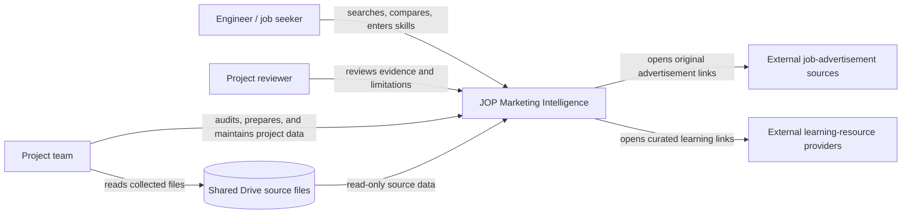

# System Context Diagram

This diagram shows the product's external actors and dependencies. It does not imply that the application directly scrapes external job boards or learning providers.

## Boundary Notes

- The project team owns the transformation and presentation of its collected sample.
- The original Drive files remain read-only source material.
- External job and learning websites control their own availability and content.
- The product should not imply that it has complete coverage of an external labor market.
