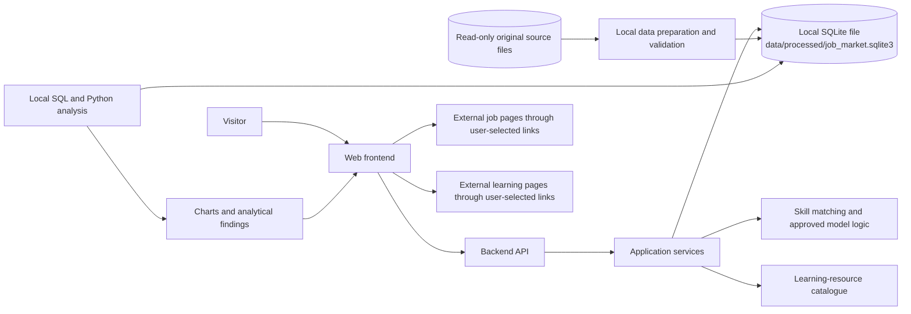

# Container Architecture Diagram

The local SQLite container is implemented. The frontend, API, and application services remain planned; any implementation must access the database only from trusted backend code on the same machine.

## Interaction Rules

- The frontend communicates with the backend API; it does not connect directly to the SQLite file.
- The backend opens only a local filesystem database path. There is no remote database service or network database fallback.
- Data preparation, analytical notebooks, and the user-facing application remain separate responsibilities.
- Any future approved model inference runs inside the same backend process; no separate ML service or model server is in scope. Until a model passes its evidence/evaluation gate, its work remains offline and report-only.
- Original source files are read-only inputs; database loading writes only to the local SQLite file.
- External links are opened by the visitor and are not application-controlled services.
