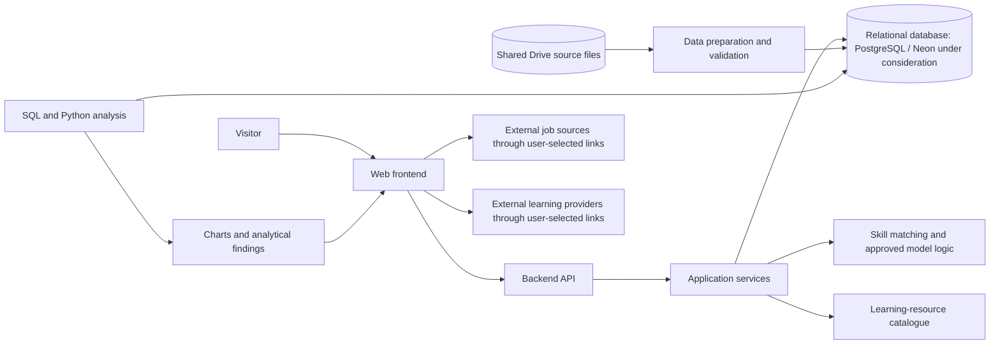

# Container Architecture Diagram

This is a proposed logical container view. Technology and hosting choices remain open.

## Interaction Rules

- The frontend communicates with the backend API; it does not connect directly to the database.
- Data preparation, analytical notebooks, and the user-facing application are separate responsibilities.
- Model logic may be served by the backend only after passing its evaluation gate; otherwise, model work remains report-only.
- External links are opened by the visitor and are not application-controlled services.
