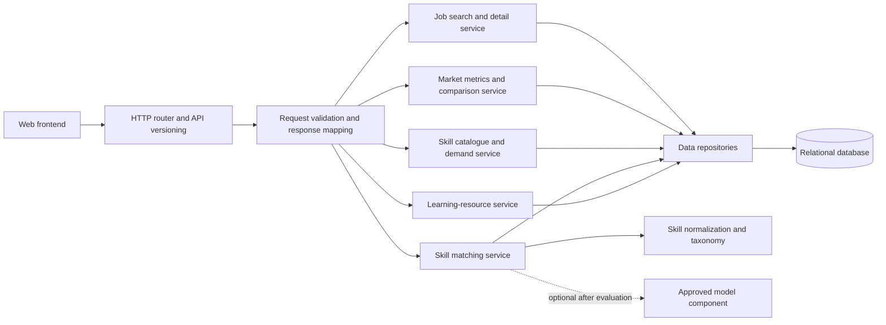

# Backend Component Diagram

The diagram shows proposed responsibilities behind the API. It is independent of the final programming framework.

## Component Boundaries

- **Router:** Maps versioned paths and HTTP methods to application operations.
- **Validation:** Enforces input size, formats, allowed filters, and safe response behavior.
- **Services:** Implement product rules without tying them to a specific user-interface framework.
- **Repositories:** Own database queries and map rows to application-level records.
- **Skill taxonomy:** Resolves reviewed aliases to canonical skills while preserving unrecognized input for the current request only, subject to D-015.
- **Optional model component:** May be called only after its task-specific data and evaluation gates pass.
