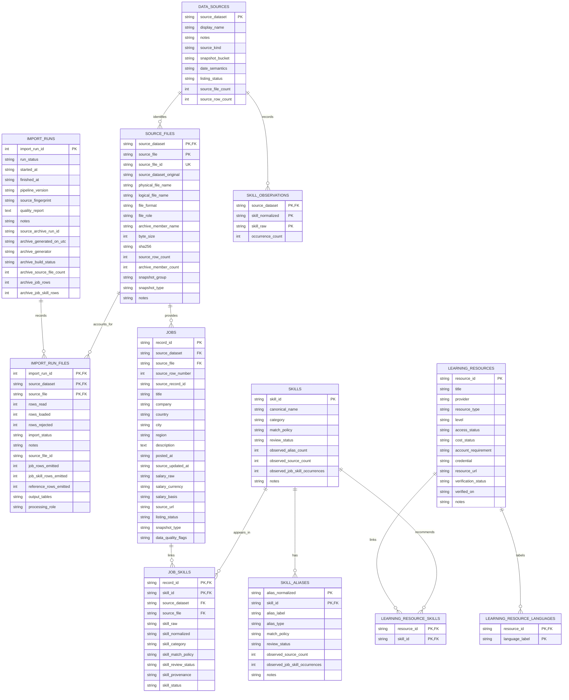

# Logical Entity-Relationship Diagram

**Status:** Aligns with the implemented local SQLite schema in `database/migrations/001_initial_sqlite_schema.sql` and `002_full_archive_provenance.sql`. The domain tables and foreign-key constraints are executable; this diagram describes the complete local data model rather than a hosted database design.

## Integrity and Modeling Notes

- `source_files` uses a composite `(source_dataset, source_file)` primary key. `jobs` references that pair, and `job_skills` references both the job provenance tuple and its skill. The migration includes a corresponding unique job key for this composite relationship.
- Migration 002 preserves archive-level source kind, date/listing semantics, original file IDs and checksums, archive member details, emitted row counts, and the upstream archive-run identity. A synthetic local `archive_integrity` source key represents the archive bundle record whose original source dataset is null.
- `(record_id, skill_id)` is the primary key of `job_skills`, preventing duplicate job-skill associations.
- `company`, `country`, `city`, and `region` remain source fields on `jobs`; separate normalized company/location tables are not part of the current dataset model.
- Date and salary columns preserve source text; `posted_at` remains separate from `source_updated_at`. The schema does not invent a collection date or numeric salary.
- Learning-resource languages are stored as labels from the curated source, not standardized codes. Resource access and cost data retain their verification status/date and are not current availability guarantees.
- User accounts, saved jobs, searches, and persistent skill profiles are out of scope.
