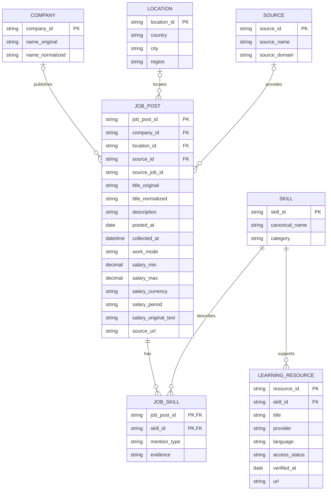

# Logical Entity-Relationship Diagram

**Status:** Provisional logical ERD. Entity and field candidates must be checked against the actual source files before schema implementation. Optional attributes and relationships may not be available in the collected data.

## Design Notes

- `JOB_SKILL` is the junction entity for the many-to-many relationship between advertisements and skills.
- Company and location references are optional when the source does not provide reliable values.
- The `mention_type` field should distinguish required, preferred, or unspecified only when the source supports that interpretation.
- Salary fields are optional and must not combine incompatible currencies or pay periods.
- `posted_at` and `collected_at` represent different events.
- The ERD does not include user, saved-job, saved-search, or notification entities in the current scope.
