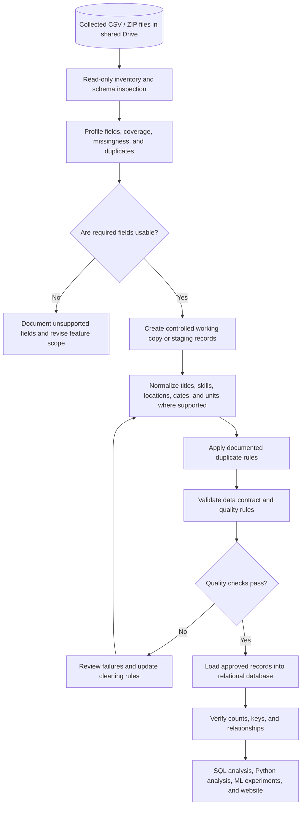

# Data Pipeline and Quality Gates

The pipeline preserves original source files and makes each transformation reviewable.

## Gate Requirements

- Do not modify the original Drive files.
- Preserve source values and record transformation decisions.
- Do not load data until the data dictionary and relational model are reviewed.
- Send failed quality checks back for review; do not silently discard or invent values.
- Record the loaded dataset version and counts for downstream analyses.
