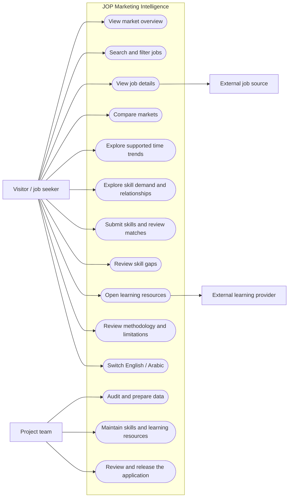

# Use Case Diagram

This diagram summarizes the in-scope capabilities for the visitor and project team. It does not include account management, saved items, or alerts.

## Scope Notes

- Time trends and some market comparisons are conditional on data coverage.
- Matching is explainable skill coverage, not a hiring probability.
- The visitor can navigate to external sources; the product does not control those sites.
