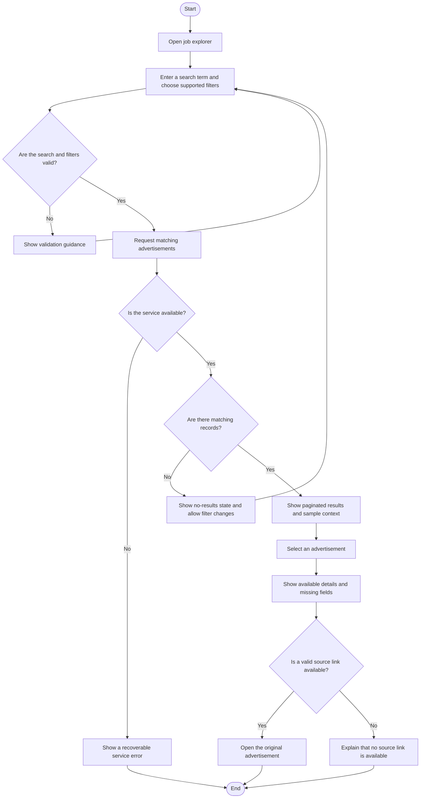

# Job Discovery Activity Diagram

## Data Integrity Notes

The list and detail page display only audited fields. Missing salary, employer, location, or date values remain missing and are never converted to fabricated values.
