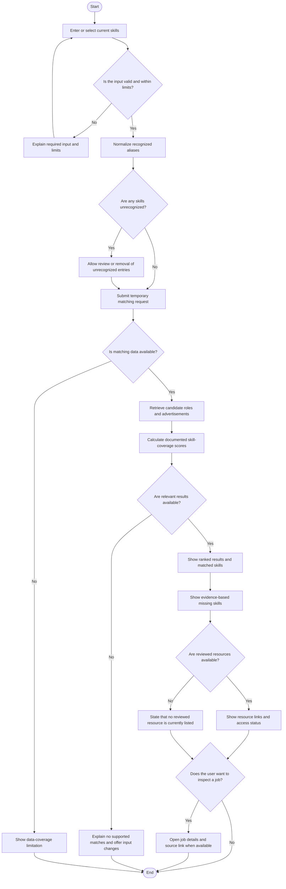

# Skill-Matching Activity Diagram

## Privacy Note

The proposed default is to process skills for the current request only and not persist them. Confirm this decision under D-015 before implementation. The matching score must not be described as the probability of being hired.
