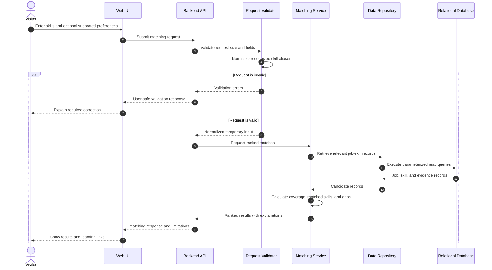

# Skill-Matching Sequence Diagram

This sequence describes the proposed request flow. The non-persistence behavior is subject to team approval under D-015.

## Security and Privacy Boundaries

- The browser does not access the database directly.
- The API validates all user-controlled fields.
- The repository uses parameterized read operations.
- Matching input should not be stored or written to request-body logs under the proposed D-015 default.
