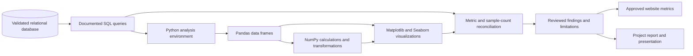

# SQL and Python Analytics Workflow

## Controls

- Use SQL for reproducible aggregation and filtering; use Python for exploration, validation, and visualization.
- Keep database credentials outside notebooks and source control.
- Record metric definitions, filters, sample sizes, units, and date coverage.
- Reconcile the values selected for the interface against the source queries.
