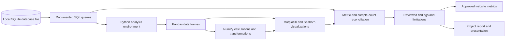

# SQL and Python Analytics Workflow

## Controls

- Use SQL for reproducible aggregation and filtering; use Python for exploration, validation, and visualization.
- Open the local SQLite file through Python; keep private data and generated database files out of notebooks and source control.
- Record metric definitions, filters, sample sizes, units, and date coverage.
- Reconcile the values selected for the interface against the source queries.
