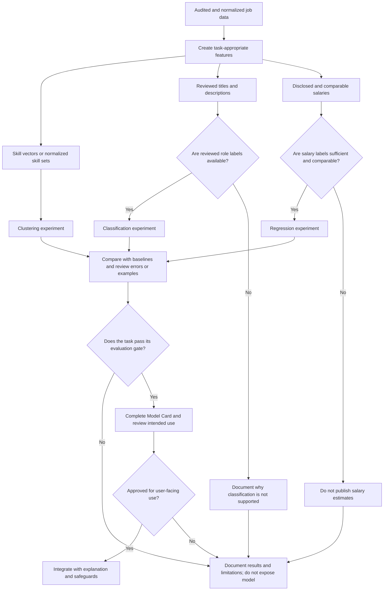

# Machine Learning Lifecycle and Release Gates

## Interpretation

- Clustering does not require labels, but clusters need human interpretation and validation.
- Classification requires reliable labels and per-class evaluation.
- Regression requires enough disclosed salaries with compatible units and periods.
- A model that fails its gate may still be documented as an experiment, but its outputs must not be presented as validated product advice.
- The explainable skill-coverage baseline is evaluated separately and remains distinct from a hiring-probability claim.
