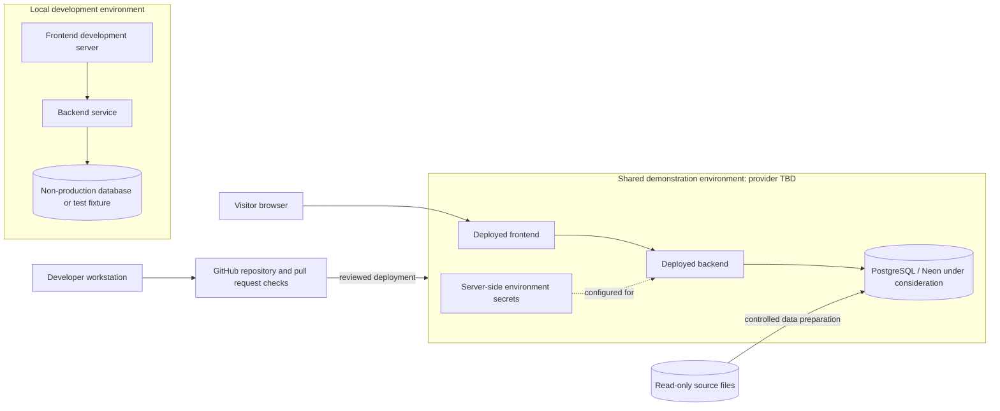

# Logical Deployment View

This diagram shows a platform-neutral deployment proposal. Hosting providers and environment configuration remain open decisions.

## Environment Rules

- Local, shared test, and demonstration settings must not reuse production secrets where separation is available.
- The browser receives no database credentials.
- Data preparation and database migrations are reviewed independently of frontend deployment.
- Do not modify source files in Drive as part of a deployment.
- If separate environments are unavailable, document how test operations are prevented from overwriting demonstration data.
