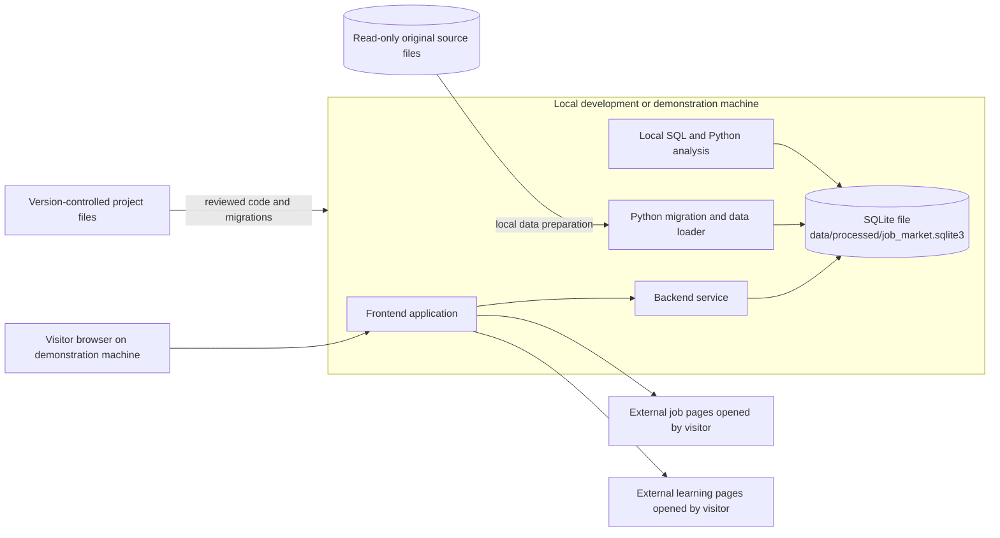

# Local Deployment View

The database deployment is local by design: the trusted backend, SQLite file, loader, and local analysis run on the same machine. The project does not configure a hosted database or remote database endpoint.

## Environment Rules

- Automated tests use temporary local SQLite files; they must not overwrite the demonstration database.
- The browser receives no database path or direct file access.
- Any future approved model inference runs inside the same backend process; do not deploy a separate ML service/server.
- `JOP_DATABASE_PATH` may select another local filesystem path; connection URLs are rejected.
- Keep generated SQLite files and backups local and out of Git; the default path is already ignored.
- Migrations and data loads are reviewed independently of frontend changes.
- Do not modify original source files in Drive as part of a local import.
- A future application host must still keep SQLite on that host's local persistent storage; selecting a hosted database is outside the current decision.
