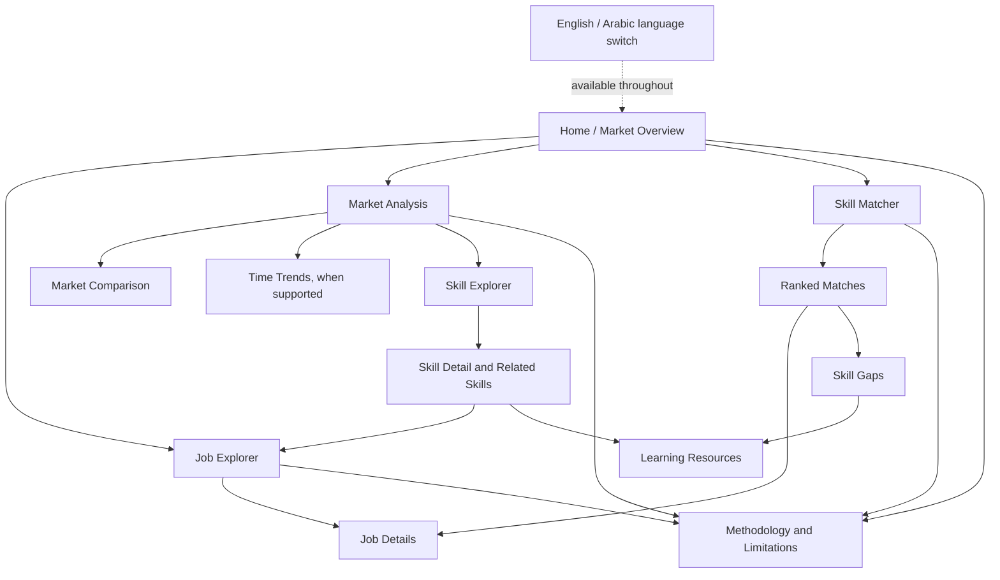

# Proposed Site Map

## Navigation Notes

- Time trends are visible only when date coverage passes the data-quality gate.
- The original advertisement and learning provider are external destinations, not internal pages.
- The language switch applies across all primary product pages and relevant states.
