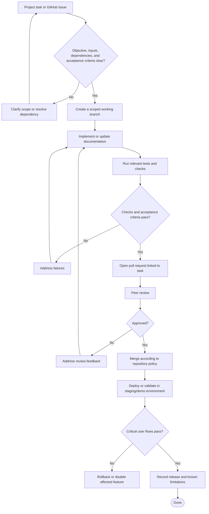

# Development and Release Flow

## Process Notes

- Keep tasks small enough for focused review.
- Do not bypass data-quality or model-evaluation gates to meet a release date.
- Update requirements, diagrams, ADRs, and traceability records when the design changes.
