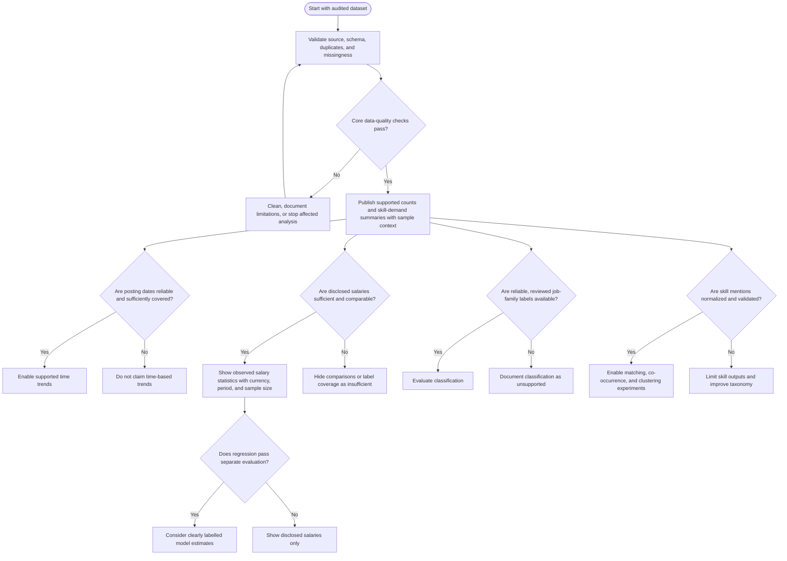

# Data-Quality Decision Tree

This diagram defines when the project may publish specific insights. Decisions must be based on measured coverage and documented thresholds agreed by the team.

## Decision Rules

- A field is not reliable merely because it is present; validate meaning, consistency, and missingness.
- Define numeric sufficiency thresholds after measuring the dataset and reviewing intended comparisons.
- Do not infer salary, dates, locations, or job-family labels that are absent from the source.
- Show an unsupported state or limitation rather than a misleading chart or model output.
