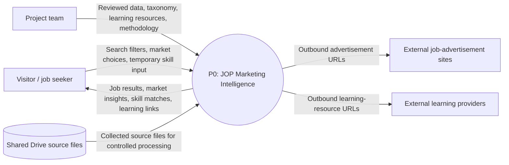

# Data Flow Diagram — Level 0

This context-level DFD treats JOP Marketing Intelligence as one process and shows its external actors and data exchanges.

## Boundary Notes

- User-entered skill data is temporary under the proposed D-015 privacy baseline, pending team approval.
- The product links to external sites but does not control them.
- The source files are inputs to a controlled data-preparation process, not a live scraping integration.
