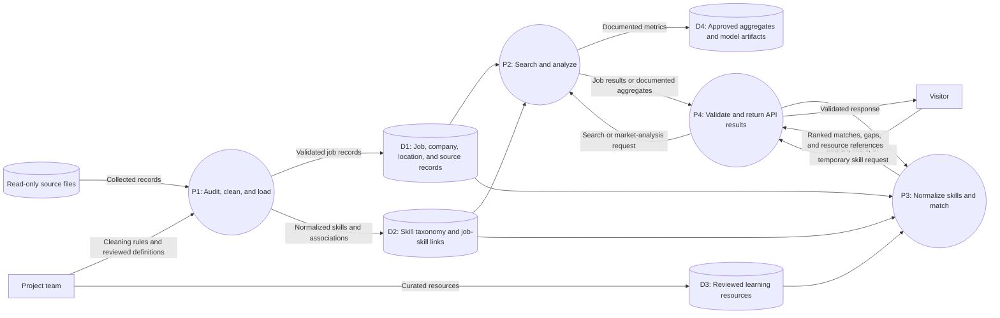

# Data Flow Diagram — Level 1

This DFD decomposes the product into major processes and logical data stores. It is a logical view; the final database schema and deployment boundaries remain subject to review.

## Interpretation

- The visitor interacts with the API-facing process and does not access data stores directly.
- Data preparation is controlled by the project team and does not modify the original Drive source.
- Model artifacts are stored or served only if an evaluation gate is passed; otherwise, results remain in project reports.
