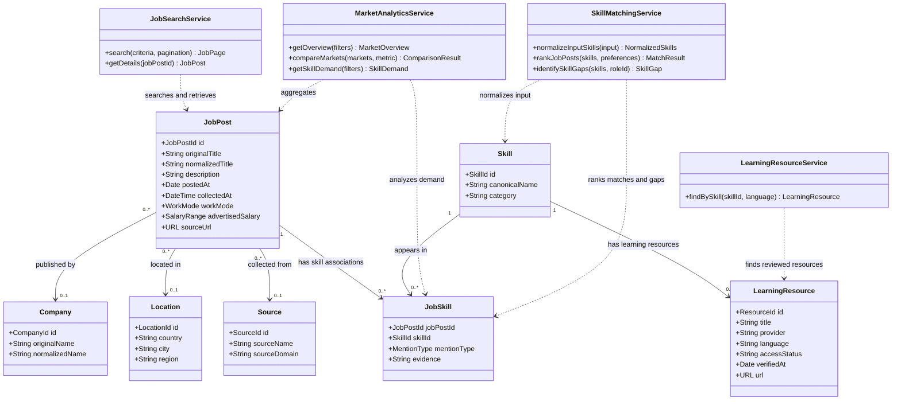

# Conceptual Domain Class Diagram

This UML-style class diagram complements the relational ERD by showing the conceptual objects and associations. It is not an implemented object model; attributes must be confirmed against the dataset.

## Modeling Notes

- The diagram includes candidate domain objects and proposed service operations. Method names describe responsibilities, not committed implementation signatures.
- A skill mention is not automatically a mandatory qualification.
- Salary and work-mode attributes may be unavailable for many advertisements.
- A persistent user or candidate-profile class is not included in the current scope.
