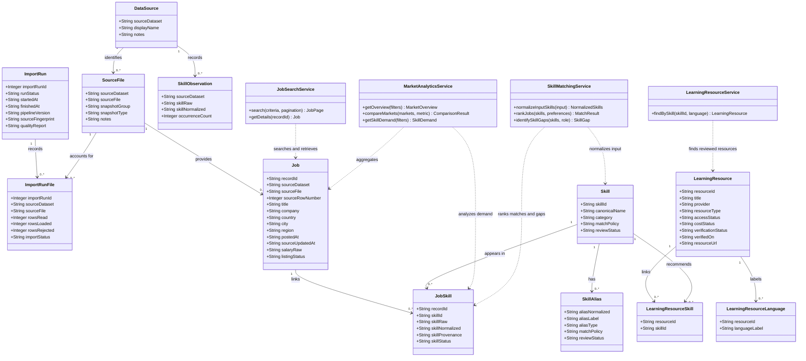

# Domain Class Diagram

This diagram gives an object-oriented view of the implemented SQLite domain model and the planned application services. Database classes map to the local relational schema in [`04_LOGICAL_ERD.md`](04_LOGICAL_ERD.md); service methods remain conceptual until the API is implemented.

## Modeling Notes

- `Job` retains source company and location values as fields; they are not separate normalized database entities.
- Date and salary values retain their source text and semantics. The model does not infer posting dates, collection timestamps, or numeric salary amounts.
- A skill mention is not automatically a mandatory qualification.
- Resource cost, language, access, and verification data are specific to the curated record and are not guarantees of current access.
- A persistent user or candidate-profile class is not included in the current scope.
