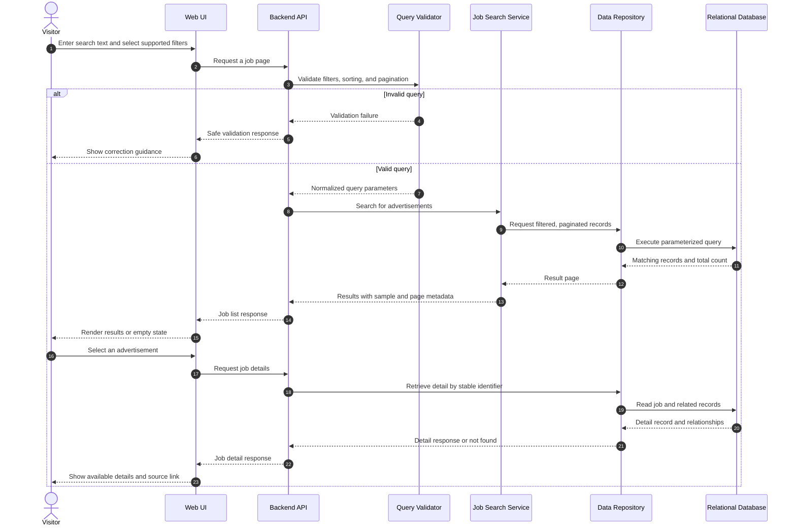

# Job Search Sequence Diagram

## Contract Notes

- Filter and sort options must be allowlisted and supported by the audited schema.
- The database query is parameterized and paginated.
- A valid search with no matches returns an empty result state.
- Missing detail fields remain unavailable rather than being inferred.
