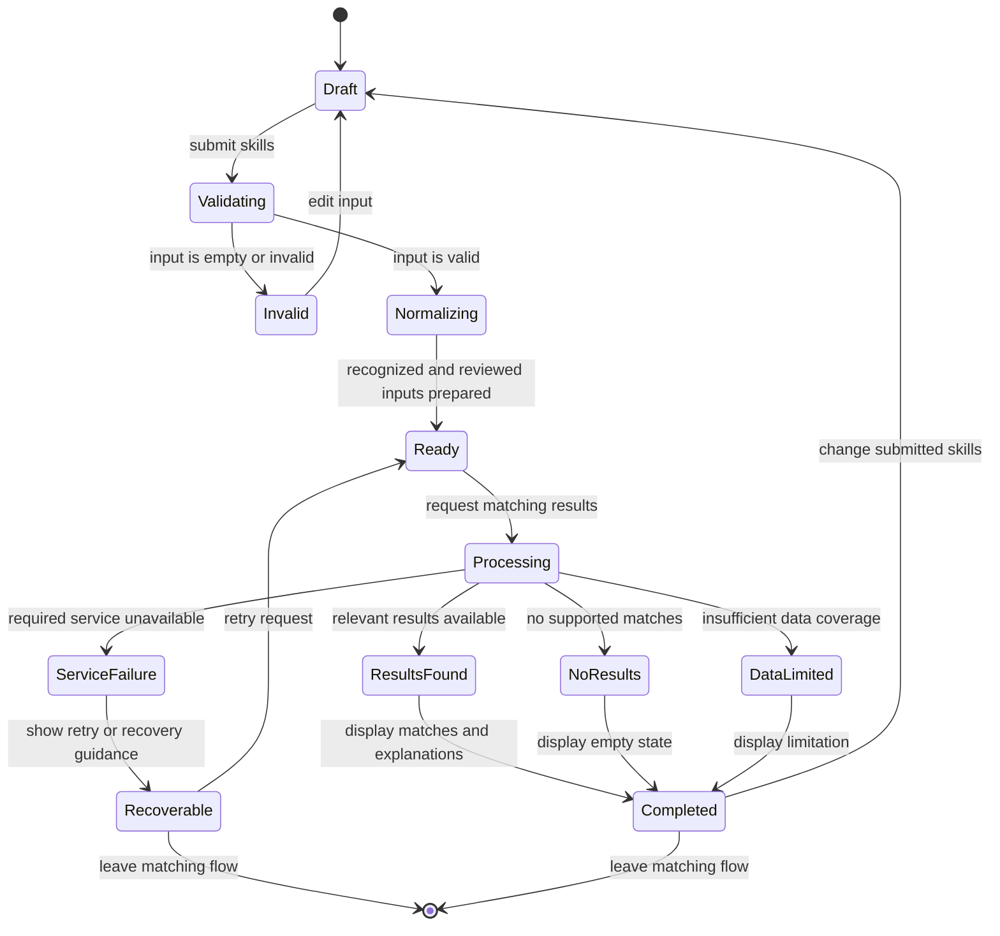

# Skill-Matching Request State Diagram

This conceptual state machine describes a single matching interaction. It does not imply that a request or skill profile is stored permanently. The proposed non-persistence behavior remains subject to team approval under D-015.

## State Rules

- Invalid input returns the visitor to an editable draft state.
- Only a valid request proceeds to normalization and matching.
- No-results and insufficient-data outcomes are distinct states.
- Service failure must not be displayed as a valid empty result.
- Under D-015, request content is not retained after the current interaction.
