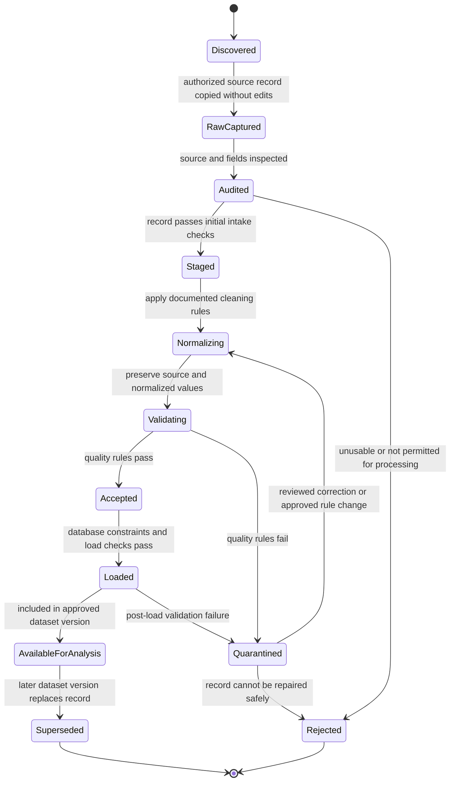

# Job-Advertisement Data Record State Diagram

This state machine describes the proposed preparation lifecycle for an individual source record. These are conceptual processing states; the implementation may track them through pipeline logs rather than a status column in the production database.

## State Rules

- Raw source files remain unchanged; transformations create separate outputs.
- Every transition should be traceable to a documented validation or transformation rule.
- A record that fails validation is quarantined or rejected, not silently deleted.
- `AvailableForAnalysis` does not mean an advertisement is still active on its source website.
