# Cleaned-Audit Relational SQLite ERD

**Status:** Target physical/logical schema for importing `jobs_cleaned_audited.csv.gz` into SQLite. It extends the domain model in [`04_LOGICAL_ERD.md`](04_LOGICAL_ERD.md), uses migrations `001`–`006`, and preserves the existing application-facing `jobs` model. The diagram below is generated from the executable SQLite migrations, including composite foreign keys and the API rollup tables.

```mermaid
erDiagram
    API_HISTORICAL_MONTH_ROLLUPS {
        string source_dataset PK
        string month PK
        string country_key PK
        string country_label
        int job_record_count
    }
    API_ROLE_SCOPE_ROLLUPS {
        string source_dataset PK
        string country_key PK
        string country_label
        string work_mode_key PK
        string work_mode_label
        string experience_key PK
        string experience_label
        string role_id PK
        string role_display_title
        int job_record_count
        int eligible_job_record_count
        int records_with_salary_text
        int records_with_explicit_currency
        int records_with_unverified_salary
    }
    API_ROLE_SKILL_ROLLUPS {
        string source_dataset PK
        string country_key PK
        string work_mode_key PK
        string experience_key PK
        string role_id PK
        string skill_id PK, FK
        string canonical_name
        string category
        int job_record_count
    }
    API_SCOPE_ROLLUPS {
        string source_dataset PK
        string country_key PK
        string country_label
        string work_mode_key PK
        string work_mode_label
        string experience_key PK
        string experience_label
        int job_record_count
        int eligible_job_record_count
    }
    API_SCOPE_SKILL_ROLLUPS {
        string source_dataset PK
        string country_key PK
        string work_mode_key PK
        string experience_key PK
        string skill_id PK, FK
        string canonical_name
        string category
        int job_record_count
    }
    API_SOURCE_FIELD_COVERAGE {
        string source_dataset PK, FK
        int job_record_count
        int title_records
        int company_records
        int country_records
        int city_records
        int description_records
        int source_url_records
        int salary_raw_records
        int posted_at_records
        int work_mode_raw_records
    }
    DATA_SOURCES {
        string source_dataset PK
        string display_name
        string notes
        string source_kind
        string snapshot_bucket
        string date_semantics
        string listing_status
        int source_file_count
        int source_row_count
    }
    IMPORT_RUN_FILES {
        int import_run_id PK, FK
        string source_dataset PK, FK
        string source_file PK, FK
        int rows_read
        int rows_loaded
        int rows_rejected
        string import_status
        string notes
        string source_file_id
        int job_rows_emitted
        int job_skill_rows_emitted
        int reference_rows_emitted
        string output_tables
        string processing_role
    }
    IMPORT_RUNS {
        int import_run_id PK
        string run_status
        string started_at
        string finished_at
        string pipeline_version
        string source_fingerprint
        string quality_report
        string notes
        string source_archive_run_id
        string archive_generated_on_utc
        string archive_generator
        string archive_build_status
        int archive_source_file_count
        int archive_job_rows
        int archive_job_skill_rows
    }
    JOB_CLEANING_AUDIT {
        string record_id PK, FK
        string source_dataset FK
        string source_file FK
        int source_row_number
        string source_record_id
        string source_record_id_duplicate_occurrence
        string record_origin
        string source_platform
        string title_raw
        string title_clean
        string title_key
        string company_raw
        string company_clean
        string country_raw
        string country_standardized
        string location_scope
        string city_raw
        string region_raw
        string location_raw
        string work_mode_raw
        string remote_flag_raw
        string employment_type_raw
        string experience_raw
        int experience_years_min
        int experience_years_max
        string experience_parse_status
        string category_raw
        string description_raw
        int description_char_count
        string posted_at_raw
        string posted_at_iso
        string source_updated_at_raw
        string source_updated_at_iso
        string source_collected_at_raw
        string source_collected_at_iso
        string collection_date_field
        string source_date_field
        string date_quality_flags
        string salary_raw
        string salary_candidate_raw
        string salary_source_field_used
        string salary_local_source_value
        string salary_usd_source_value
        string salary_range_est_source_value
        string salary_currency_raw
        string salary_basis_raw
        string salary_rate_raw
        string salary_source_raw
        string salary_sources_raw
        string salary_fill_source_raw
        string salary_estimate_source_url
        string salary_estimate_source_date
        string salary_estimate_source_date_status
        string salary_value_type
        string salary_provenance_status
        string salary_parse_status
        float salary_amount_1_original_currency
        float salary_amount_2_original_currency
        float salary_min_original_currency
        float salary_max_original_currency
        float salary_midpoint_original_currency
        string salary_range_kind
        string salary_currency_code
        string salary_currency_detection_status
        string salary_period_code
        string salary_period_detection_status
        float salary_annualized_min_native
        float salary_annualized_max_native
        float salary_annualized_midpoint_native
        string salary_reporting_currency
        float salary_fx_rate_to_reporting_currency
        string salary_fx_rate_source
        string salary_fx_rate_date
        float salary_annualized_min_reporting_currency
        float salary_annualized_max_reporting_currency
        string salary_comparability_status
        string salary_statistics_eligible
        string salary_integrity_flags
        string salary_iqr_outlier_flag
        string skills_raw
        string skills_base_raw
        string skills_tokens_json
        string skill_ids_json
        int skill_token_count_raw
        int skill_token_count_unique
        int skill_canonical_id_count
        int skill_duplicate_token_count
        string skills_source_raw
        string skills_enrichment_status
        string source_url_raw
        string source_url_syntax_status
        string listing_status
        string snapshot_type
        string exact_duplicate_within_source
        string encoding_suspected_mojibake
        string data_quality_flags
        string source_row_json
        string salary_original
        string salary_source_value_type
        string salary_estimation_status
        string salary_estimate_currency_code
        string salary_estimation_method
        string salary_estimation_source
        string salary_estimation_confidence
        int salary_estimate_reference_count
        string salary_estimation_as_of_date
        float salary_annualized_midpoint_reporting_currency
        float salary_annual_min_usd
        float salary_annual_salary_usd
        float salary_annual_max_usd
        float salary_annual_min_egp
        float salary_annual_salary_egp
        float salary_annual_max_egp
        float salary_annual_min_sar
        float salary_annual_salary_sar
        float salary_annual_max_sar
        string salary_estimate_range_basis
        string role_family
        string seniority_band
        string location_clean
        string location_key
        string work_mode_standardized
        string employment_type_standardized
    }
    JOB_SKILLS {
        string record_id PK, FK
        string source_dataset FK
        string source_file FK
        string skill_raw
        string skill_normalized
        string skill_id PK, FK
        string skill_category
        string skill_match_policy
        string skill_review_status
        string skill_provenance
        string skill_status
    }
    JOBS {
        string record_id PK
        string source_dataset FK
        string source_file FK
        int source_row_number
        string source_record_id
        string record_origin
        string source_platform
        string title
        string title_short
        string company
        string country
        string city
        string region
        string location_raw
        string work_mode_raw
        string remote_flag
        string employment_type_raw
        string experience_raw
        string category_raw
        string description
        string posted_at
        string source_updated_at
        string source_date_field
        string salary_raw
        string salary_rate
        string salary_year_avg
        string salary_hour_avg
        string salary_currency
        string salary_basis
        string salary_source
        string salary_provenance_status
        string skills
        string skills_original
        string skills_source
        string skills_enrichment_status
        string source_url
        string listing_status
        string snapshot_type
        string exact_duplicate_within_source
        string data_quality_flags
    }
    LEARNING_RESOURCE_LANGUAGES {
        string resource_id PK, FK
        string language_label PK
    }
    LEARNING_RESOURCE_SKILLS {
        string resource_id PK, FK
        string skill_id PK, FK
    }
    LEARNING_RESOURCES {
        string resource_id PK
        string title
        string provider
        string resource_type
        string level
        string access_status
        string cost_status
        string account_requirement
        string credential
        string resource_url
        string verification_status
        string verified_on
        string notes
    }
    SKILL_ALIASES {
        string alias_normalized PK
        string alias_label
        string skill_id PK, FK
        string alias_type
        string match_policy
        string review_status
        int observed_source_count
        int observed_job_skill_occurrences
        string notes
    }
    SKILL_OBSERVATIONS {
        string source_dataset PK, FK
        string skill_raw PK
        string skill_normalized PK
        int occurrence_count
    }
    SKILLS {
        string skill_id PK
        string canonical_name
        string category
        string match_policy
        string review_status
        int observed_alias_count
        int observed_source_count
        int observed_job_skill_occurrences
        string notes
    }
    SOURCE_FILES {
        string source_dataset PK, FK
        string source_file PK
        string snapshot_group
        string snapshot_type
        string notes
        string source_file_id UK
        string source_dataset_original
        string physical_file_name
        string logical_file_name
        string file_format
        string file_role
        string archive_member_name
        int byte_size
        string sha256
        int source_row_count
        int archive_member_count
    }

    DATA_SOURCES ||--o{ API_SOURCE_FIELD_COVERAGE : summarizes
    DATA_SOURCES ||--o{ SKILL_OBSERVATIONS : records
    DATA_SOURCES ||--o{ SOURCE_FILES : identifies
    IMPORT_RUNS ||--o{ IMPORT_RUN_FILES : records
    JOBS ||--o{ JOB_SKILLS : links
    JOBS ||--o| JOB_CLEANING_AUDIT : stores_cleaned_columns
    LEARNING_RESOURCES ||--o{ LEARNING_RESOURCE_LANGUAGES : labels
    LEARNING_RESOURCES ||--o{ LEARNING_RESOURCE_SKILLS : links
    SKILLS ||--o{ API_ROLE_SKILL_ROLLUPS : summarizes
    SKILLS ||--o{ API_SCOPE_SKILL_ROLLUPS : summarizes
    SKILLS ||--o{ JOB_SKILLS : appears_in
    SKILLS ||--o{ LEARNING_RESOURCE_SKILLS : recommends
    SKILLS ||--o{ SKILL_ALIASES : has
    SOURCE_FILES ||--o{ IMPORT_RUN_FILES : accounts_for
    SOURCE_FILES ||--o{ JOBS : provides
```



## What the schema preserves

- `job_cleaning_audit` has **all 123 cleaned CSV columns under their exact source names**, including `source_row_json`. It is keyed by `record_id` and has a composite foreign key to the corresponding `jobs(record_id, source_dataset, source_file)` row. `cleaned_jobs` is a convenience view over this full-fidelity table.
- The existing `jobs` table retains the project's application-compatible fields. The loader fills its core search fields from cleaned values; the exact raw, standardized, salary, skill-token, date, and provenance columns remain authoritative in `job_cleaning_audit`.
- The 123 audit columns use 9 `INTEGER` fields, 21 `REAL` fields, and 93 `TEXT` fields. Empty CSV cells become SQL `NULL`; the original serialized source row remains available for exact source-level review.
- `job_skills` is populated from `skill_ids_json` and references both `jobs` and `skills`. Parsed source labels are counted into `skill_observations`; `skills_tokens_json` and `skill_ids_json` remain intact in the audit table. Any label-resolution fallback uses a catalog canonical name, while its original arrays remain preserved.
- `data_sources`, `source_files`, `import_runs`, and `import_run_files` retain source provenance and import checksums. Curated skill, alias, and learning-resource files populate their corresponding normalized tables.
- `api_*_rollups` are derived read models from migration `004`; they are rebuilt from the imported relational rows. `schema_migrations` is SQLite migration bookkeeping and is intentionally not an ERD domain entity.

## Relationships and keys

- `source_files` has composite primary key `(source_dataset, source_file)`; `jobs` and `import_run_files` reference that pair.
- `jobs.record_id` is the job primary key and `(record_id, source_dataset, source_file)` is also unique for provenance-safe foreign keys.
- `job_cleaning_audit.record_id` is both its primary key and part of its composite foreign key to `jobs`, giving each job at most one audit row.
- `(record_id, skill_id)` is the `job_skills` primary key. Skill matching/recommendation eligibility remains controlled by the catalog's review and match-policy fields.
- `(resource_id, skill_id)` and `(resource_id, language_label)` are composite keys for learning-resource links and language labels.

## Views and analysis

The migration also creates `actual_salary_rows` and `synthetic_salary_estimates` views. They separate reported eligible salaries from any explicitly labelled synthetic estimates; the imported cleaning policy determines which rows are present in each view.

Examples:

```sql
SELECT country_standardized, COUNT(*) AS job_count
FROM cleaned_jobs
GROUP BY country_standardized
ORDER BY job_count DESC;

SELECT s.canonical_name, COUNT(DISTINCT js.record_id) AS job_count
FROM job_skills AS js
JOIN skills AS s ON s.skill_id = js.skill_id
GROUP BY s.skill_id, s.canonical_name
ORDER BY job_count DESC;
```

Build the full database from the cleaned CSV and its matching cleaning summary with:

```bash
python scripts/database_loading/build_cleaned_relational_sqlite.py
```

The selected summary is `analysis/reports/data_cleaning/cleaning_summary.json`; its SHA-256 matches the complete Drive dataset used for this import. The builder verifies the CSV SHA-256 and row count against that summary, checks all 123 columns against migration `006`, validates foreign keys and API rollups, and runs `PRAGMA integrity_check` before atomically publishing `data/processed/jobs_cleaned_audited.sqlite3`. Use `--replace` only for a deliberate rebuild.
