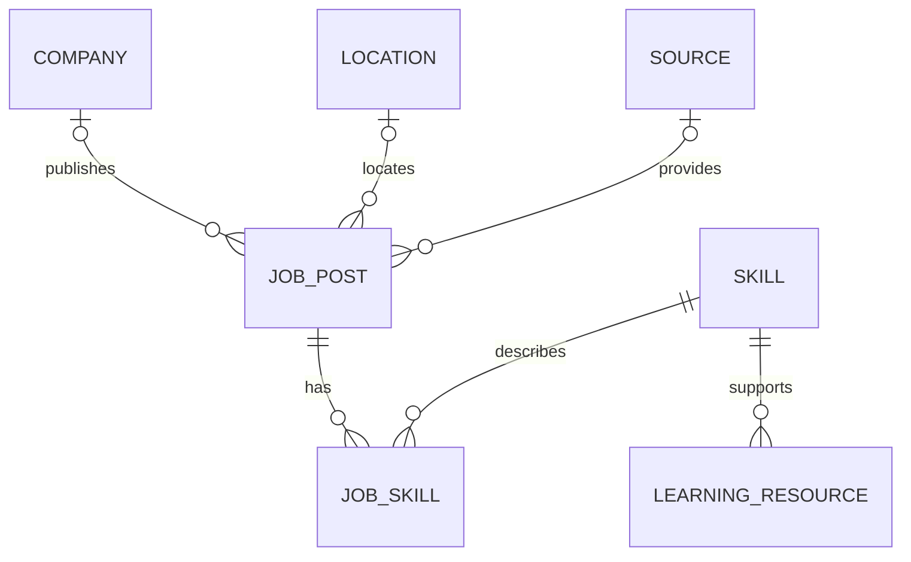

# Database Specification

**Status:** Logical proposal only. Physical field types, constraints, and schema must be finalized after T01 dataset inspection and T04 ERD review.

## Database Goals

- Support relational analysis and application queries.
- Preserve provenance and distinguish original source values from standardized values.
- Represent the many-to-many relationship between job advertisements and skills.
- Avoid treating missing or inferred fields as observed facts.

## Proposed Entities

| Entity | Purpose | Candidate attributes to confirm |
|---|---|---|
| Job Post | One collected job advertisement | Stable ID, original title, normalized title, description, posting date, collection date, work arrangement, experience, original salary text, normalized salary range/currency/period, source URL, company/location/source references |
| Company | Employer named in an advertisement | Stable ID, original name, normalized name |
| Location | Location associated with an advertisement | Stable ID, country, city, region, standardized country code where available |
| Source | Platform or source from which an advertisement was collected | Stable ID, source name, source URL/domain, collection metadata |
| Skill | Standardized skill and aliases | Stable ID, canonical name, optional category, aliases |
| Job Skill | Association between an advertisement and a skill | Job ID, skill ID, mention classification if reliably distinguishable, extraction/source evidence where feasible |
| Learning Resource | Reviewed resource associated with a skill | Stable ID, skill ID, title, provider, URL, language, level, access status, verification date |

Company and location relationships may be optional when an advertisement does not provide those values. The initial release does not require user, saved-job, saved-search, or notification tables.

## Relationship Cardinalities

- One company may be associated with zero or many job posts; each job post has zero or one known company.
- One location may be associated with zero or many job posts; each job post has zero or one normalized location.
- One source may be associated with many job posts; each job post should retain its source where available.
- Job posts and skills have a many-to-many relationship represented by Job Skill.
- One skill may be associated with many learning resources.

## ERD Concept

Cardinality notation should be confirmed when the ERD is finalized against actual source data.

## Integrity and Normalization Rules

- Assign stable primary keys independent of display titles.
- Use foreign keys for company, location, source, skill, and resource relationships.
- Prevent duplicate skill links for the same job and canonical skill.
- Preserve original title, salary text, and relevant source text alongside normalized values.
- Store unknown values as null or an explicitly documented unknown state, not as fabricated defaults.
- Make salary units explicit; do not compare ranges with incompatible currencies or pay periods.
- Keep posting date distinct from collection date.
- Record the source URL or source identifier where available to support deduplication and traceability.

## Deduplication Policy

The final policy must be decided after inspecting the data. Candidate signals include source posting ID, normalized source URL, normalized employer, title, location, and posting date. Do not delete records solely because their titles match; distinct advertisements can share a title. Preserve a documented decision trail for deduplicated records.

## Query and Index Strategy

Index choices should follow observed query patterns and explainable performance measurements. Candidate indexes include job title, normalized country/location, work arrangement, posting date, source, and junction-table foreign keys. Full-text search and salary indexes are conditional on the selected database and actual workload. Avoid adding indexes without evidence because they increase storage and write cost.

## Migrations and Access

- Store schema changes as ordered, reviewable migrations after implementation begins.
- Test migrations against a non-production database before deployment.
- Use separate credentials or roles where the hosting plan supports them; the application should receive only the access it needs.
- Do not store connection secrets in this repository.
- Validate record counts, foreign-key integrity, nullability, and salary normalization after every load.

## Open Schema Questions

Exact columns, data types, uniqueness rules, role taxonomy, currency conversion policy, source retention, and whether model outputs are stored in the database remain unresolved until the data audit and architecture review are complete.
